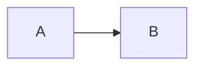

# Markdown and streaming

## Supported syntax

Render supports headings, paragraphs, ordered/unordered lists, blockquotes, tables, task lists, strikethrough, links, images, code highlighting, and footnotes. Task checkboxes are display-only. Ordinary HTML is displayed as text; there is no switch to execute arbitrary HTML or Vue templates.

Put uppercase [TOC] on its own line to generate a table of contents. Heading/footnote IDs are isolated per component instance. Use the IDs emitted by headings-change rather than guessing anchor strings.

````markdown
# Example

[TOC]

- [x] Completed
- [ ] Pending

```ts
const message = 'hello';
```



Inline math: $E=mc^2$

$$
a^2 + b^2 = c^2
$$

A note[^note].

[^note]: Additional explanation.
````

Highlighting, KaTeX, and Mermaid load asynchronously on demand. Failures retain source and emit error. Formulas require vmo-markdown-render/math.css.

For model-facing instructions, use the [simple/detailed output prompts](./model-prompts), available in both languages. These Render features are broader than Input's editing subset.

## Images

```markdown

```

Images are lazy-loaded and fill the content width by default, with proportional height independent of fontBaseSize. unstyled delegates image appearance to the host. Without baseUrl, the browser resolves relative URLs against the current page; resource settings below can set a base or proxy.

<script setup>
import MediaProtocol from "../../examples/MediaProtocol.vue";
</script>

<ClientOnly><MediaProtocol /></ClientOnly>

### Explicit media directives (recommended)

This is a single-line leaf subset of Generic Directives. The image/audio/video names and attributes form this library's media protocol v1, not an official CommonMark media standard. Types are explicit, independent of URL suffixes.

```markdown


::image[Advanced image]{src="/images/example.png" width="60%" title="Optional title"}

::audio[Recording]{src="/media/example.mp3" type="audio/mpeg"}

::video[Demo]{src="/media/example.mp4" type="video/mp4" poster="/images/cover.png" width="80%"}
```

Each directive occupies one line. src is required; brackets contain a plain-text description (image alt or player aria-label). title is optional. Double quotes are recommended; single quotes, unquoted values without spaces, Markdown escapes and entities are supported. Inline/container directives, nested bodies and class/id shortcuts are not supported. Custom components retain their existing registered-tag design.

Images/video default to 100% width. width accepts only percentages greater than 0% and at most 100%; invalid values fall back to 100%. Height follows the original aspect ratio; height is not configurable. Audio remains full-width and ignores width. Explicit widths also apply in unstyled mode; default unstyled layout is host-controlled. Neither media dimensions nor image dimensions scale with fontBaseSize.

Audio/video accept an optional MIME type matching their category, such as audio/mpeg or video/mp4; invalid types are ignored. Video poster is resolved as an image resource. src and poster use baseUrl/resolveUrl. Controls are enabled, preload is metadata, autoplay is disabled, and video uses playsinline. Resource failures follow browser behavior; rejected URLs/conversion failures remove the address and emit a resource error.

Unknown attributes and the original directive remain in internal parse nodes but are not forwarded to DOM; event/style/autoplay attributes do not execute. There is no Markdown exporter yet. Unknown/malformed/incomplete directives remain text. Streaming recognizes only complete original lines; the completion helper cannot manufacture a media request.

## Audio and video

Legacy single-URL audio/video fences remain supported; prefer the explicit directives above for new documents.

````markdown
```audio
/media/example.mp3
```

```video
/media/example.mp4
```
````

Render uses native controls, preload=metadata, no autoplay, and playsinline for video. Media is full-width by default; images/video use --md-radius. unstyled delegates appearance to the host. Native controls inherit color-scheme, subject to browser support.

No title or multiline configuration is supported inside media fences. Invalid blocks remain code. Playback depends on URL availability, server behavior, and browser codecs. Ordinary links/images do not become media players; third-party iframes are not embedded. Media resources must be supplied by the host, not invented by a model.

## Alerts

```markdown
> [!WARNING] Before release
> Verify configuration.
```

| Marker | Semantic color |
| --- | --- |
| IMPORTANT | primary |
| NOTE / INFO | info |
| TIP / SUCCESS | success |
| WARNING | warning |
| CAUTION / DANGER / ERROR | danger |

INFO, SUCCESS, DANGER, and ERROR are library aliases. TIP means a tip, not proof of a successful action. Titles use the inline title first, then alertLabels keyed by uppercase marker, then the default English label.

```vue
<MarkdownRender :content="content" :alert-labels="{ IMPORTANT: 'Important', NOTE: 'Note', TIP: 'Tip', WARNING: 'Warning' }" />
```

## Streaming content

Always pass the complete accumulated document. Append network chunks in host state. Set streaming=true during generation and false after completion or interruption:

```vue
<script setup lang="ts">
import { ref } from 'vue';
import { MarkdownRender } from 'vmo-markdown-render';
const content = ref('');
const streaming = ref(false);
async function consume(chunks: AsyncIterable<string>) {
  content.value = ''; streaming.value = true;
  try { for await (const chunk of chunks) content.value += chunk; }
  finally { streaming.value = false; }
}
// Pass your network chunk iterable to consume(chunks).
</script>
<template><MarkdownRender :content="content" :streaming="streaming" /></template>
```

Streaming attempts temporary display completion; final parsing uses the original source. Business tags mount only after complete syntax arrives. Text rules need explicit completion boundaries; see [components](./components) and [rules](./text-rules).

## Resource URLs and proxies

baseUrl resolves relative image/audio/video URLs. resolveUrl synchronously rewrites the resolved URL for a proxy/CDN/prepared signed resource:

```vue
<script setup lang="ts">
import { MarkdownRender, type ResourceUrlResolver } from 'vmo-markdown-render';
const content = '';
const resolveUrl: ResourceUrlResolver = (url, { type, originalUrl }) => {
  console.log(type, originalUrl);
  return `/api/resource-proxy?url=${encodeURIComponent(url)}`;
};
</script>
<template><MarkdownRender :content="content" base-url="https://example.com/docs/article/" :resolve-url="resolveUrl" /></template>
```

With that base:

- ./cover.png becomes https://example.com/docs/article/cover.png.
- ../audio.mp3 becomes https://example.com/docs/audio.mp3.
- /video.mp4 becomes https://example.com/video.mp4.
- Absolute URLs retain their origin; protocol-relative URLs use the base protocol.

baseUrl must be absolute. A directory base should end in /; otherwise standard URL rules treat the path as a file. Without a base, relative addresses remain relative for the browser. SSR does not depend on window/current page URLs.

The callback is synchronous and may run more than once. Fetch signed URLs before rendering, not in the callback. type identifies image/audio/video without relying on file extensions. This setting does not rewrite ordinary links, code, rule-generated VNodes, or resources inside business components.

Both pre/post conversion URLs reject unsafe schemes. Built-in resources accept HTTP(S) and relative paths, not data/blob/file/javascript URLs. Empty sources make no request. Invalid bases, callback failures, or invalid rewritten sources remove src and emit a resource error rather than request the original address.

URL rewriting does not create a proxy server. The host supplies it, including access controls and Range request support for media.


Mermaid measures in a dedicated hidden, offscreen container that retains layout. Temporary SVGs do not appear outside the content or enlarge the page. Rendering is queued to isolate themes. Theme-only updates retain the current diagram until its replacement succeeds; failures fall back to source and emit a mermaid-stage error. Stale results cannot replace newer content. Measurement containers are removed in finally when rendering settles, including failed or unmounted renders.

Mermaid fits the container at the default 12px baseline, then scales with fontBaseSize. Enlarged diagrams can extend beyond their viewport and be panned, rather than being forced back down by max-width. The shared --md-font-max-size cap still applies to scaled text.

Protocol details: directive/attribute names are case-sensitive; src must be lowercase. Repeated attributes use the last value. All v1 attribute values are strings with an equals sign; boolean shorthand, JSON parameters and suffix-based type inference are not supported. Once metadata loads, video dimensions take precedence over a differently shaped poster. Changing src/MIME recreates the player to reload it; changing width alone does not.
