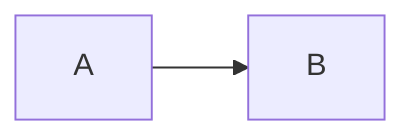
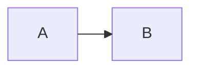

# Markdown and streaming

## Supported syntax

Render supports headings, paragraphs, ordered/unordered lists, blockquotes, tables, task lists, strikethrough, links, images, code highlighting, and footnotes. Task checkboxes are display-only. Ordinary HTML is displayed as text; there is no switch to execute arbitrary HTML or Vue templates.

Put uppercase [TOC] on its own line to generate a table of contents. Heading/footnote IDs are isolated per component instance. Use the IDs emitted by headings-change rather than guessing anchor strings.

````markdown
# Example

[TOC]

- [x] Completed
- [ ] Pending

```ts
const message = 'hello';
```



Inline math: $E=mc^2$

$$
a^2 + b^2 = c^2
$$

A note[^note].

[^note]: Additional explanation.
````

Highlighting, KaTeX, and Mermaid load asynchronously on demand. Failures retain source and emit error. Formulas require vmo-markdown-render/math.css.

For model-facing instructions, use the [simple/detailed output prompts](./model-prompts), available in both languages. These Render features are broader than Input's editing subset.

## Images

```markdown

```

Images are lazy-loaded and fill the content width by default, with proportional height independent of fontBaseSize. unstyled removes prose theming but retains basic image-container layout and its default 100% width; the host may override appearance. Without baseUrl, the browser resolves relative URLs against the current page; resource settings below can set a base or proxy.

### Full-screen image preview

Standard Markdown images and ::image directives use the same built-in image component with lazy loading, URL resolution and preview. Click, or focus and press Enter/Space, to open. Images inside links keep their navigation behavior. The body-teleported overlay avoids clipping by the content container. Only one preview is active across Render instances; removing/changing its source, disabling preview or unmounting Render closes it and cleans up resources.

```vue
<MarkdownRender
  :content="content"
  :image-preview="{
    enabled: true,
    background: { light: '#ffffff', dark: '#151821' },
    maxScale: 2,
  }"
/>
```

| Option | Default | Behavior |
| --- | --- | --- |
| enabled | true | false closes/disables preview; passing imagePreview=false does the same |
| background | Originating Render background | CSS color or per-theme light/dark colors; unspecified modes follow Render |
| maxScale | 2 | Relative to the initial fit; finite values clamped to 1–2, NaN/Infinity fall back to 2; 2 doubles each side and quadruples area |
| longPressDownload | Deprecated | Compatibility only, no effect; does not restore menus |
| reference | true | Show the thumbnail reference button on hover, 5px from the bottom-left; image-reference notifies the host independently of preview |

The effective theme, background and text color follow the originating Render, including inherited dark mode, auto and themeColors, and update with those settings while open. Required full-screen interaction styles remain in unstyled mode. Wheel zoom anchors to the pointer; mouse/single-finger dragging pans, and two fingers zoom/pan together. An axis stays centered until the scaled image exceeds that viewport dimension. Touch holds do not open an application menu or download anything.

Hover over the thumbnail to reveal its bottom-left reference button (5px inset); activating it emits image-reference without opening preview. See [standalone images and event payloads](../api/markdown-render#standalone-images-and-reference-events). The initial/minimum fit reserves 50px on every viewport edge. Images that already fit retain their natural size; larger images shrink proportionally. This initial size is 100%, and zoom cannot go below it. The default ceiling is 200%: twice the width and height, four times the area. The margin applies only to fitting; enlarged images can occupy the entire viewport and pan on overflowing axes. Resize recalculates the fit. maxScale can lower the ceiling within 1–2; invalid values default to 2 and legacy larger values are capped at 2. Body image width and fontBaseSize do not constrain the overlay. Keyboard +/− zoom and 0 resets. Click empty background or press Escape to close; Image clicks and gestures do not dismiss the preview. The read-only percentage follows wheel/pinch and shortcut zoom. Tab/Shift+Tab retain dialog focus. There is no numeric input to activate the mobile keyboard. Closing restores scrolling and connected prior focus.

### Preview integration boundaries

imagePreview is a host Render prop, not a Markdown attribute: preview/maxScale/style on ::image do not configure the overlay. There is no per-image Markdown override, controlled-open method or gallery navigation API; the reference action emits image-reference. Use `[](/image.png)` for a navigable image. MarkdownImage is a public standalone package export; using it inside injected components or textRules VNodes also shares Render preview and reference events. Plain img elements do not automatically join preview. The lightbox and injection key remain internal.

The context menu and download/original-image actions have been removed. longPressDownload is a deprecated compatibility option with no effect, including when true. The image region cancels contextmenu and sets -webkit-touch-callout: none to suppress iOS image callouts. There is no automatic download. Browser/WebView native menus require target-device checks. The percentage is read-only, with no input field.

Preview uses the final src after baseUrl/resolveUrl, with no separate high-resolution URL. Opening may load/decode the image again; browser caching determines reuse. Keep signed/proxied URLs valid for the interaction. Load failures show local feedback without emitting Render error; resolver failures retain resource-stage errors. There is no download request, filename handling or download-CORS fallback.

Because Teleport mounts under body, source-container scoped variables and ancestor selectors do not follow the overlay. Prefer background/theme/themeColors configuration with actual CSS colors. background is not validated through the ThemeColor format checker. The fixed overlay locks body scrolling. Arbitrary external CSS/background changes are sampled on opening or relevant theme configuration updates, not continuously observed.

<script setup>
import MediaProtocol from '../../examples/MediaProtocol.vue';
import ImagePreviewDemo from '../../examples/ImagePreviewDemo.vue';
</script>

<ClientOnly><ImagePreviewDemo /></ClientOnly>

<<< ../../examples/ImagePreviewDemo.vue

See [preview API](../api/markdown-render#image-preview-options) and [manual checks](./testing#manual-speech-and-image-preview-checks).

### Standard and advanced images

<ClientOnly><MediaProtocol /></ClientOnly>

### Explicit media directives (recommended)

This is a single-line leaf subset of Generic Directives. The image/audio/video names and attributes form this library's media protocol v1, not an official CommonMark media standard. Types are explicit, independent of URL suffixes.

```markdown


::image[Advanced image]{src="/images/example.png" width="60%" title="Optional title"}

::audio[Recording]{src="/media/example.mp3" type="audio/mpeg"}

::video[Demo]{src="/media/example.mp4" type="video/mp4" poster="/images/cover.png" width="80%"}
```

Each directive occupies one line. src is required; brackets contain a plain-text description (image alt or player aria-label). title is optional. Double quotes are recommended; single quotes, unquoted values without spaces, Markdown escapes and entities are supported. Inline/container directives, nested bodies and class/id shortcuts are not supported. Custom components retain their existing registered-tag design.

Images/video default to 100% width. width accepts only percentages greater than 0% and at most 100%; invalid values fall back to 100%. Height follows the original aspect ratio; height is not configurable. Audio remains full-width and ignores width. Explicit widths also apply in unstyled mode; images retain their default 100% container width, while videos without explicit width use host-controlled layout. Neither media dimensions nor image dimensions scale with fontBaseSize.

Audio/video accept an optional MIME type matching their category, such as audio/mpeg or video/mp4; invalid types are ignored. Video poster is resolved as an image resource. src and poster use baseUrl/resolveUrl. Controls are enabled, preload is metadata, autoplay is disabled, and video uses playsinline. Resource failures follow browser behavior; rejected URLs/conversion failures remove the address and emit a resource error.

Unknown attributes and the original directive remain in internal parse nodes but are not forwarded to DOM; event/style/autoplay attributes do not execute. There is no Markdown exporter yet. Unknown/malformed/incomplete directives remain text. Streaming recognizes only complete original lines; the completion helper cannot manufacture a media request.

## Audio and video

Legacy single-URL audio/video fences remain supported; prefer the explicit directives above for new documents.

````markdown
```audio
/media/example.mp3
```

```video
/media/example.mp4
```
````

Render uses native controls, preload=metadata, no autoplay, and playsinline for video. Media is full-width by default; images/video use --md-radius. unstyled delegates appearance to the host. Native controls inherit color-scheme, subject to browser support.

No title or multiline configuration is supported inside media fences. Invalid blocks remain code. Playback depends on URL availability, server behavior, and browser codecs. Ordinary links/images do not become media players; third-party iframes are not embedded. Media resources must be supplied by the host, not invented by a model.

## Alerts

```markdown
> [!WARNING] Before release
> Verify configuration.
```

| Marker | Semantic color |
| --- | --- |
| IMPORTANT | primary |
| NOTE / INFO | info |
| TIP / SUCCESS | success |
| WARNING | warning |
| CAUTION / DANGER / ERROR | danger |

INFO, SUCCESS, DANGER, and ERROR are library aliases. TIP means a tip, not proof of a successful action. Titles use the inline title first, then alertLabels keyed by uppercase marker, then the default English label.

```vue
<MarkdownRender :content="content" :alert-labels="{ IMPORTANT: 'Important', NOTE: 'Note', TIP: 'Tip', WARNING: 'Warning' }" />
```

## Streaming content

Always pass the complete accumulated document. Append network chunks in host state. Set streaming=true during generation and false after completion or interruption:

```vue
<script setup lang="ts">
import { ref } from 'vue';
import { MarkdownRender } from 'vmo-markdown-render';
const content = ref('');
const streaming = ref(false);
async function consume(chunks: AsyncIterable<string>) {
  content.value = ''; streaming.value = true;
  try { for await (const chunk of chunks) content.value += chunk; }
  finally { streaming.value = false; }
}
// Pass your network chunk iterable to consume(chunks).
</script>
<template><MarkdownRender :content="content" :streaming="streaming" /></template>
```

Streaming attempts temporary display completion; final parsing uses the original source. Business tags mount only after complete syntax arrives. Text rules need explicit completion boundaries; see [components](./components) and [rules](./text-rules).

## Resource URLs and proxies

baseUrl resolves relative image/audio/video URLs. resolveUrl synchronously rewrites the resolved URL for a proxy/CDN/prepared signed resource:

```vue
<script setup lang="ts">
import { MarkdownRender, type ResourceUrlResolver } from 'vmo-markdown-render';
const content = '';
const resolveUrl: ResourceUrlResolver = (url, { type, originalUrl }) => {
  console.log(type, originalUrl);
  return `/api/resource-proxy?url=${encodeURIComponent(url)}`;
};
</script>
<template><MarkdownRender :content="content" base-url="https://example.com/docs/article/" :resolve-url="resolveUrl" /></template>
```

With that base:

- ./cover.png becomes https://example.com/docs/article/cover.png.
- ../audio.mp3 becomes https://example.com/docs/audio.mp3.
- /video.mp4 becomes https://example.com/video.mp4.
- Absolute URLs retain their origin; protocol-relative URLs use the base protocol.

baseUrl must be absolute. A directory base should end in /; otherwise standard URL rules treat the path as a file. Without a base, relative addresses remain relative for the browser. SSR does not depend on window/current page URLs.

The callback is synchronous and may run more than once. Fetch signed URLs before rendering, not in the callback. type identifies image/audio/video without relying on file extensions. This setting does not rewrite ordinary links, code, rule-generated VNodes, or resources inside business components.

Both pre/post conversion URLs reject unsafe schemes. Built-in resources accept HTTP(S) and relative paths, not data/blob/file/javascript URLs. Empty sources make no request. Invalid bases, callback failures, or invalid rewritten sources remove src and emit a resource error rather than request the original address.

### Resource load failures

URL conversion and browser loading fail at different stages. Failures do not automatically remove media elements:

| Failure | Display | Render error event |
| --- | --- | --- |
| Invalid baseUrl, throwing resolver or invalid rewritten URL | Remove src but retain the element; failed poster conversion removes only poster | resource stage |
| Image HTTP, network or decoding failure | Retain img; browser-specific broken-image, alt or blank display, with no common placeholder | Not forwarded automatically |
| Audio/video HTTP or decoding failure | Retain native controls; playback fails and browser-specific feedback may appear | Not forwarded automatically |
| Preview image load failure | Show a local image-load failure message in the overlay | Not forwarded automatically |

Standalone MarkdownImage forwards native image @error Event objects, unlike Render MarkdownError. It does not execute baseUrl/resolveUrl; supply its final src yourself. See [native image events](../api/markdown-image#load-failures-and-native-events).

URL rewriting does not create a proxy server. The host supplies it, including access controls and Range request support for media.


## Mermaid layout and rendering

Mermaid measures in a dedicated hidden, offscreen container that retains layout. Temporary SVGs do not appear outside the content or enlarge the page. Rendering is queued to isolate themes. Theme-only updates retain the current diagram until its replacement succeeds; failures fall back to source and emit a mermaid-stage error. Stale results cannot replace newer content. Measurement containers are removed in finally when rendering settles, including failed or unmounted renders.

Dagre is the default layout to reduce the main-thread computation used by Mermaid 12's default ELK layout. Node positions and edge routes differ from ELK. To opt into ELK, set `config.layout` in frontmatter at the start of the Mermaid source. Queued diagrams that have been replaced or unmounted are skipped before rendering; layouts already running must finish. Opening or closing an image preview does not rerun existing diagram layouts.

````markdown

````

Mermaid fits the container at the default 12px baseline, then scales with fontBaseSize. Enlarged diagrams can extend beyond their viewport and be panned, rather than being forced back down by max-width. The shared --md-font-max-size cap still applies to scaled text.

Protocol details: directive/attribute names are case-sensitive; src must be lowercase. Repeated attributes use the last value. All v1 attribute values are strings with an equals sign; boolean shorthand, JSON parameters and suffix-based type inference are not supported. Once metadata loads, video dimensions take precedence over a differently shaped poster. Changing src/MIME recreates the player to reload it; changing width alone does not.
