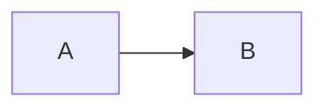

# Markdown 与流式渲染

## 支持的语法

支持标题、列表、引用、表格、任务列表、删除线、链接、图片、代码高亮与脚注。任务列表仅展示，不提供编辑事件。原生 HTML 按文本显示，没有启用 HTML 或 Vue 模板编译的开关。

`[TOC]` 独占一行生成目录；标题与脚注 ID 在组件实例间隔离，应使用 `headings-change` 返回的 id，不要自行推测锚点值。

````markdown
# 示例

[TOC]

- [x] 已完成
- [ ] 待处理

```ts
const message = 'hello';
```



行内公式：$E=mc^2$

$$
a^2 + b^2 = c^2
$$
````

高亮、KaTeX、Mermaid 按需异步加载。加载或渲染失败会保留源码并触发 `error`；公式需要额外导入 `vmo-markdown-render/math.css`。

## 提示块

```markdown
> [!WARNING] 发布前检查
> 请确认配置已更新。
```

| 标记 | 语义色 |
| --- | --- |
| IMPORTANT | primary |
| NOTE / INFO | info |
| TIP / SUCCESS | success |
| WARNING | warning |
| CAUTION / DANGER / ERROR | danger |

INFO、SUCCESS、DANGER、ERROR 是本库别名；TIP 表示技巧。标题优先级为 Markdown 内自定义标题、`alertLabels` 对应的大写键、默认英文类型名。

```vue
<MarkdownRender
  :content="content"
  :alert-labels="{ IMPORTANT: '重点', NOTE: '备注', TIP: '建议', WARNING: '警告' }"
/>
```

## 流式内容

`content` 始终传入已收到的完整内容，每个网络分片追加到宿主状态；开始时开启 `streaming`，结束或中断后关闭。

```vue
<script setup lang="ts">
import { ref } from 'vue';
import { MarkdownRender } from 'vmo-markdown-render';

const content = ref('');
const streaming = ref(false);
async function consume(chunks: AsyncIterable<string>) {
  content.value = '';
  streaming.value = true;
  try {
    for await (const chunk of chunks) content.value += chunk;
  } finally {
    streaming.value = false;
  }
}
// 将你的网络分片异步迭代器传给 consume(chunks)。
</script>

<template>
  <MarkdownRender :content="content" :streaming="streaming" />
</template>
```

流式模式尝试补全 Markdown 展示，生成结束后重新按原文解析。组件标签必须完整才挂载；正则规则需自行设置结束条件，详见 [组件注入](./components) 与 [正则规则](./text-rules)。
